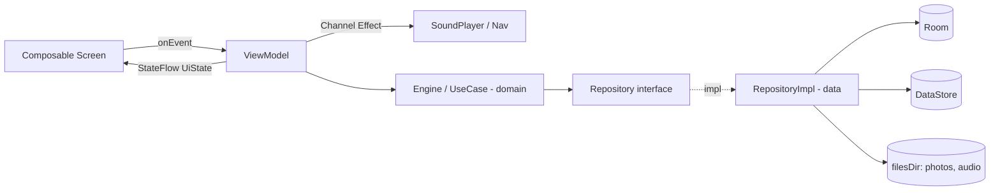

# 01 · Architektura

## 1. Założenia
- Jeden moduł Gradle `:app` z podziałem na pakiety (Clean Architecture w pakietach). Podział na moduły Gradle dopiero, gdy gier będzie > 4 (ADR-002).
- Jedna `MainActivity` (single-activity), całe UI w Compose.
- Offline-first: jedyne połączenie sieciowe to sprawdzanie i pobieranie aktualizacji.
- Gry są „wtyczkami” rejestrowanymi w `GameRegistry` — nowa gra = nowy pakiet + jeden wpis w rejestrze.

## 2. Struktura pakietów

`namespace`/`applicationId`: `com.familygames` (patrz otwarte pytanie Q1 w docs/11 — ustalić przed pierwszym release, potem nie zmieniać).

```text
app/src/main/java/com/familygames/
├── FamilyGamesApp.kt                 # Application: startKoin, seed, WorkManager
├── MainActivity.kt                   # setContent, kiosk hooks, immersive mode
├── di/                               # moduły Koin: appModule, dataModule, domainModule, viewModelModule
├── data/
│   ├── local/
│   │   ├── db/                       # FamilyGamesDatabase, *Entity, *Dao, Converters, migrations
│   │   ├── prefs/                    # SettingsDataStore (Preferences DataStore)
│   │   └── files/                    # MediaStorage: zapis/odczyt JPEG, miniatur, m4a
│   ├── seed/                         # DefaultContentSeeder (ilustracje z assets/ przy pierwszym starcie)
│   ├── repository/                   # PhotoRepositoryImpl, CategoryRepositoryImpl, ProgressRepositoryImpl, SettingsRepositoryImpl
│   └── updater/                      # GitHubReleaseApi, UpdateManager, ApkVerifier, ApkInstaller, InstallResultReceiver, UpdateWorker, PackageReplacedReceiver
├── domain/
│   ├── model/                        # Photo, Category, GameId, MemoryLevel, PuzzleConfig, GameResult, Stars, UpdateInfo
│   ├── repository/                   # interfejsy repozytoriów
│   ├── game/
│   │   ├── memory/                   # MemoryEngine (maszyna stanów), DealMemoryCardsUseCase, MemoryScoring
│   │   └── puzzle/                   # SnapBoard, SwapBoard, ShuffleSwapBoardUseCase, PuzzleScoring
│   ├── parent/                       # ParentChallengeGenerator, PinHasher, GateLockoutPolicy
│   └── update/                       # VersionComparator, UpdateDecision
├── kiosk/
│   ├── FamilyDeviceAdminReceiver.kt
│   ├── KioskManager.kt               # DPM: lock task packages, features, HOME, restrykcje; start/stopLockTask
│   └── KioskStatus.kt
├── presentation/
│   ├── navigation/                   # Routes (@Serializable), FamilyNavHost
│   ├── common/                       # BigRoundButton, KidTile, Stars, WinOverlay, ConfettiCanvas, HoldToActivateButton, SoundPlayer, ScreenScaffold
│   ├── menu/                         # MainMenuScreen, MainMenuViewModel
│   ├── games/
│   │   ├── GameRegistry.kt
│   │   ├── memory/                   # MemoryLevelScreen, MemoryScreen, MemoryViewModel, MemoryCard
│   │   └── puzzle/                   # PuzzleSetupScreen, SnapPuzzleScreen, SwapPuzzleScreen, PuzzleViewModel(s), DragDropBoard
│   ├── parent/
│   │   ├── gate/                     # ParentGateDialog, ParentGateViewModel
│   │   ├── photos/                   # PhotoManagerScreen, PhotoEditScreen, CropView, VoiceRecorder
│   │   ├── categories/               # CategoriesScreen
│   │   ├── progress/                 # ProgressScreen
│   │   ├── settings/                 # SettingsScreen (kiosk, update, PIN, dźwięk)
│   │   └── onboarding/               # FirstRunScreen
│   └── theme/                        # Color.kt, Type.kt, Shape.kt, Dimens.kt, KidTheme, ParentTheme
└── util/                             # DispatcherProvider, Clock, BitmapUtils
```

## 3. Przepływ danych



Zasady:
- `UiState` jest niemutowalny (`data class`, listy `ImmutableList` z kotlinx.collections.immutable lub zwykłe `List` + `@Immutable`).
- ViewModel nie trzyma referencji do `Context`. Dostęp do plików i dźwięku przez interfejsy wstrzykiwane Koinem.
- Repozytoria zwracają `Flow` dla danych obserwowanych (lista zdjęć, postępy) i `suspend` dla operacji jednorazowych.

## 4. Nawigacja (typowane trasy)

```kotlin
@Serializable object MenuRoute
@Serializable object MemoryLevelsRoute
@Serializable data class MemoryPlayRoute(val level: MemoryLevel, val categoryId: Long)
@Serializable object PuzzleSetupRoute
@Serializable data class SnapPuzzleRoute(val photoId: Long, val rows: Int, val cols: Int)
@Serializable data class SwapPuzzleRoute(val photoId: Long, val size: Int)
@Serializable object ParentGraph          // zagnieżdżony graf rodzica
@Serializable object ParentPhotosRoute
@Serializable data class ParentPhotoEditRoute(val photoId: Long? = null, val pendingUris: List<String> = emptyList())
@Serializable object ParentCategoriesRoute
@Serializable object ParentProgressRoute
@Serializable object ParentSettingsRoute
@Serializable object FirstRunRoute
```

- Start: `FirstRunRoute`, jeśli `settings.firstRunCompleted == false`, inaczej `MenuRoute`.
- Wejście do `ParentGraph` **tylko** przez pomyślne przejście `ParentGateDialog` (gate ustawia flagę `parentSessionUntil = now + 5 min` w pamięci; wyjście z grafu ją czyści).
- `BackHandler`: w grach → powrót do menu; w menu → pochłonięty (nic się nie dzieje); w panelu rodzica → standardowy powrót.

## 5. Rejestr gier

```kotlin
data class GameEntry(
    val id: GameId,                 // MEMORY, PUZZLE, (przyszłe: COLORING, SOUND_MEMO)
    @StringRes val title: Int,
    @DrawableRes val icon: Int,
    val iconTint: Color,               // tło koła ikony; patrz docs/08 §7
    val entryRoute: Any,            // np. MemoryLevelsRoute
    val enabled: Boolean = true,
)

object GameRegistry {
    val games = listOf(
        GameEntry(GameId.MEMORY, R.string.game_memory, R.drawable.ic_game_memory, Palette.AccentSoft, MemoryLevelsRoute),
        GameEntry(GameId.PUZZLE, R.string.game_puzzle, R.drawable.ic_game_puzzle, Palette.MistSoft, PuzzleSetupRoute),
    )
}
```
Menu (S01) renderuje `games` + kafel „Wkrótce”, jeśli `games.size < 3`. Rejestracja tras gry odbywa się przez extension `NavGraphBuilder.memoryGraph()` / `puzzleGraph()` wywoływane w `FamilyNavHost`.

## 6. Moduły Koin (szkic)

```kotlin
val dataModule = module {
    single { Room.databaseBuilder(get(), FamilyGamesDatabase::class.java, "familygames.db").addMigrations(*ALL_MIGRATIONS).build() }
    single { get<FamilyGamesDatabase>().photoDao() }
    single { get<FamilyGamesDatabase>().categoryDao() }
    single { get<FamilyGamesDatabase>().gameResultDao() }
    single { SettingsDataStore(get()) }
    single { MediaStorage(get()) }
    single<PhotoRepository> { PhotoRepositoryImpl(get(), get(), get()) }
    // ...
    single { OkHttpClient.Builder().callTimeout(60, TimeUnit.SECONDS).build() }
    single { GitHubReleaseApi(get(), BuildConfig.UPDATE_REPO_OWNER, BuildConfig.UPDATE_REPO_NAME) }
    single { UpdateManager(get(), get(), get(), get()) }
}
val domainModule = module {
    factory { DealMemoryCardsUseCase(random = Random.Default) }
    factory { ParentChallengeGenerator(Random.Default) }
    single { PinHasher() }
}
val viewModelModule = module {
    viewModelOf(::MainMenuViewModel)
    viewModel { (route: MemoryPlayRoute) -> MemoryViewModel(route, get(), get(), get()) }
    // ...
}
```

## 7. Konfiguracja buildu
- `buildConfigField("String", "UPDATE_REPO_OWNER", "\"<owner>\"")`, `UPDATE_REPO_NAME`, `KIOSK_ENABLED` (debug=false, release=true).
- `versionCode`/`versionName` z właściwości Gradle `-PversionName=1.3.0`; `versionCode = major*10000 + minor*100 + patch` (1.3.0 → 10300). Lokalnie domyślnie `0.0.1` → 1.
- Release: R8 włączony (`isMinifyEnabled = true`, `isShrinkResources = true`), reguły dla kotlinx.serialization.
- Podpis release: z `keystore.properties` (lokalnie) albo zmiennych środowiskowych w CI (`config/github-workflows/release.yml`).
- Orientacja: `android:screenOrientation="sensorLandscape"`, `resizeableActivity` domyślne.

## 8. Wydajność
- Zdjęcia w grze ładowane z **miniatur** (400 px) dla Memorków; w Puzzlach pełne zdjęcie (≤1600 px) jako jeden `ImageBitmap`, fragmenty rysowane przez `drawImage(srcOffset, srcSize)` — bez tworzenia osobnych bitmap.
- `SoundPool` ładowany raz w `SoundPlayer` (singleton), max 6 strumieni.
- Cel: 60 fps animacji kart na tablecie klasy Galaxy Tab A9+ / Lenovo Tab M10; zimny start < 1,5 s (Baseline Profile w M9).
