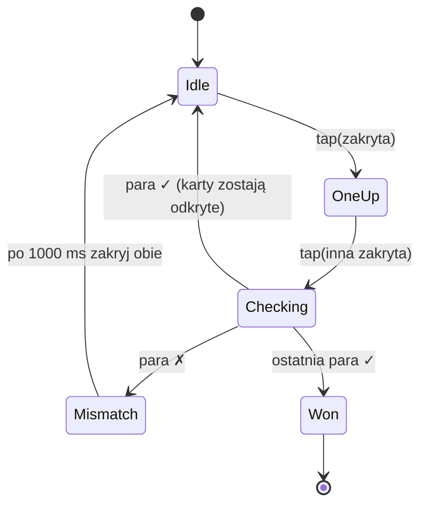

# 04 · Gra Memorki

## 1. Poziomy
| Level | Siatka | Kart | Par | Min. zdjęć w kategorii |
|---|---|---|---|---|
| L1 | 2×2 | 4 | 2 | 2 |
| L2 | 2×3 | 6 | 3 | 3 |
| L3 | 2×4 | 8 | 4 | 4 |
| L4 | 3×4 | 12 | 6 | 6 |

Wiersze × kolumny (rows × cols). Na tablecie landscape kolumn jest zawsze ≥ wierszy.

## 2. Rozdanie — `DealMemoryCardsUseCase`
```kotlin
class DealMemoryCardsUseCase(private val random: Random) {
    operator fun invoke(level: MemoryLevel, pool: List<Photo>, recentlyUsed: Set<Long> = emptySet()): List<MemoryCard> {
        require(pool.size >= level.pairs)
        // 1) preferuj zdjęcia nieużyte w ostatniej grze (różnorodność), dobierz resztę losowo
        val fresh = pool.filterNot { it.id in recentlyUsed }.shuffled(random)
        val chosen = (fresh + pool.filter { it.id in recentlyUsed }.shuffled(random)).take(level.pairs)
        // 2) duplikuj, nadaj unikalne id kart, tasuj
        return chosen.flatMap { p -> listOf(MemoryCard(id = 2 * p.id, pairKey = p.id, photo = p), MemoryCard(id = 2 * p.id + 1, pairKey = p.id, photo = p)) }
            .shuffled(random)
    }
}
```
- Reguła anty-frustracyjna dla L1–L2: po tasowaniu, jeśli obie karty pary leżą obok siebie poziomo w ≥ 2 parach, przetasuj ponownie (max 5 prób) — zbyt „łatwe” układy nie uczą. (Opcjonalne, za flagą.)
- `Random` wstrzykiwany → testy deterministyczne (`Random(42)`).

## 3. Maszyna stanów — `MemoryEngine` (domain, bez Androida)



Reguły:
- Tap na kartę odkrytą/dopasowaną → ignoruj.
- W stanach `Checking`, `Mismatch`, `Won` wejście zablokowane (`inputLocked = true`).
- Tap na tę samą kartę w `OneUp` → ignoruj (nie zakrywaj).
- Liczniki: `moves` (+1 przy każdej drugiej odkrytej karcie), `mistakes` (+1 przy chybionej parze).

```kotlin
data class MemoryUiState(
    val rows: Int, val cols: Int,
    val cards: List<CardUi>,
    val pairsFound: Int, val totalPairs: Int,
    val inputLocked: Boolean,
    val moves: Int, val mistakes: Int,
    val phase: Phase,              // Idle, OneUp, Checking, Mismatch, Won
    val stars: Int? = null,        // ustawione w Won
    val showLabels: Boolean,
)
data class CardUi(val id: Long, val pairKey: Long, val image: PhotoSource, val label: String?, val faceUp: Boolean, val matched: Boolean, val highlight: Highlight /* None, Match, Soft */)

sealed interface MemoryEvent { data class CardTapped(val id: Long): MemoryEvent; data object Restart: MemoryEvent; data object Home: MemoryEvent }
sealed interface MemoryEffect { data class Sound(val sfx: Sfx): MemoryEffect; data class Voice(val path: String): MemoryEffect; data object NavigateHome: MemoryEffect }
```

## 4. Timingi (stałe w `MemoryTimings`)
| zdarzenie | czas |
|---|---|
| obrót karty | 350 ms (`tween`, `FastOutSlowInEasing`) |
| opóźnienie sprawdzenia po 2. karcie | 400 ms od tapnięcia (czeka na koniec obrotu) |
| pokaz chybionej pary | 1000 ms (L1–L2: 1300 ms) |
| odstęp „match” → głos rodzica | 300 ms |
| po ostatniej parze → WinOverlay | 600 ms |

Implementacja w ViewModel: `viewModelScope.launch { delay(...) }` z wstrzykiwanym dispatcherem; testy przez `runTest` + `advanceTimeBy`.

## 5. Animacja karty (Compose)
```kotlin
val rotation by animateFloatAsState(if (card.faceUp || card.matched) 180f else 0f, tween(350, easing = FastOutSlowInEasing), label = "flip")
Box(Modifier.graphicsLayer { rotationY = rotation; cameraDistance = 12f * density }) {
    if (rotation <= 90f) CardBack() else CardFront(Modifier.graphicsLayer { rotationY = 180f })
}
```
- Dopasowanie: `scale` 1 → 1.04 → 1 (spring) + ramka `Accent` 4 dp + znaczek ✓ 40 dp.
- Konfetti lokalne: ~12 cząstek w kolorach palety z punktu środka obu kart (Canvas nad siatką), opacity 0.75.
- Tap feedback: `Modifier.pointerInput` z `detectTapGestures(onPress = …)` → skala 0.97.

## 6. Punktacja — `MemoryScoring`
`extra = mistakes` (liczba chybionych par):
- 3★: `mistakes ≤ pairs`
- 2★: `mistakes ≤ 2 × pairs`
- 1★: w pozostałych przypadkach (zawsze min. 1 — dziecko zawsze „wygrywa”).

## 7. Edge cases
- Kategoria zmieniona w panelu rodzica w trakcie gry → gra trwa na danych z rozdania (snapshot).
- Plik zdjęcia nie istnieje (usunięty) → Coil `error` = ilustracja zastępcza; nie przerywaj gry.
- Restart w trakcie `Mismatch` → anuluj zaplanowany `delay` (Job.cancel) przed nowym rozdaniem.
- Obrót ekranu/process death: stan gry nie jest przywracany (ekran wraca do S02) — świadome uproszczenie.

## 8. Testy wymagane (min.)
- rozdanie: liczba kart, każda para dokładnie 2×, deterministyczność dla seeda, preferencja świeżych zdjęć;
- silnik: match, mismatch + auto-zakrycie po 1000 ms, blokada wejścia, ignorowanie tapnięć w kartę odkrytą, Won po ostatniej parze, liczniki;
- punktacja: granice progów.
