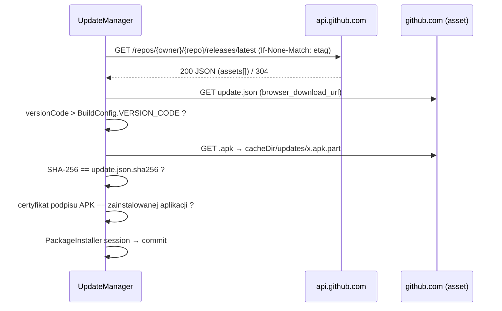

# 07 · Aktualizacje z GitHub Releases

## 1. Kontrakt wydania (Release)
Każdy Release (tag `vMAJOR.MINOR.PATCH`) zawiera **dwa** assety, tworzone przez CI (`config/github-workflows/release.yml`):

1. `familygames-<versionName>-<versionCode>.apk` — podpisany kluczem release.
2. `update.json`:
```json
{
  "schema": 1,
  "versionCode": 10300,
  "versionName": "1.3.0",
  "apkAsset": "familygames-1.3.0-10300.apk",
  "apkSize": 18350211,
  "sha256": "9b1c…64 znaki hex…",
  "minSdk": 28,
  "mandatory": false,
  "changelog": ["Nowy poziom Memorków 3×4", "Szybsze ładowanie zdjęć"],
  "publishedAt": "2026-11-20T18:00:00Z"
}
```
- `versionCode = major*10000 + minor*100 + patch` (spójne z build.gradle — docs/01 §7).
- Repozytorium z wydaniami musi być **publiczne** (brak tokenów w APK). Jeśli kod ma być prywatny → osobne publiczne repo tylko na Releases (np. `familygames-releases`); workflow publikuje tam przez `GH_RELEASES_TOKEN` (Q2 w docs/11).
- Pre-release / draft są ignorowane (endpoint `releases/latest` ich nie zwraca).

## 2. Przepływ


### Nagłówki API
`Accept: application/vnd.github+json`, `X-GitHub-Api-Version: 2022-11-28`, `User-Agent: FamilyGames/<versionName>` (wymagany przez GitHub). Limit anonimowy: 60 req/h/IP — z naszą częstotliwością bez znaczenia. Zapisuj `ETag` i wysyłaj `If-None-Match` (304 nie zużywa limitu).

## 3. Kiedy sprawdzamy
- Przy starcie aplikacji (ekran menu), jeśli `update_check_on_start` i od `update_last_check_at` minęło ≥ 6 h.
- `UpdateWorker` (WorkManager, periodic 12 h, constraints: `NetworkType.UNMETERED` gdy `update_wifi_only`, inaczej `CONNECTED`; `requiresBatteryNotLow`).
- Ręcznie: S11 → „Sprawdź teraz”.
Pobieranie odbywa się w tym samym workerze/coroutine (OkHttp, strumieniowo do pliku `.part`, potem rename). Wznowienie przerwanego pobierania przez nagłówek `Range` (opcjonalnie).

## 4. Weryfikacja przed instalacją — `ApkVerifier`
1. Rozmiar == `apkSize`.
2. SHA-256 pliku == `sha256` (hex, lowercase).
3. `packageManager.getPackageArchiveInfo(path, GET_SIGNING_CERTIFICATES)`:
   - `packageName == context.packageName`,
   - `longVersionCode == update.versionCode`,
   - zbiór SHA-256 certyfikatów podpisu (`signingInfo.apkContentsSigners`) == zbiór certyfikatów zainstalowanej aplikacji.
4. `versionCode > BuildConfig.VERSION_CODE` (brak downgrade'ów — rollback = nowe wydanie z wyższym kodem).
Jakakolwiek niezgodność → usuń plik, `UpdateState.Error(reason)`, log, ponów przy następnym cyklu.

## 5. Instalacja — `ApkInstaller`
```kotlin
val installer = context.packageManager.packageInstaller
val params = PackageInstaller.SessionParams(PackageInstaller.SessionParams.MODE_FULL_INSTALL).apply {
    setAppPackageName(context.packageName)
    if (Build.VERSION.SDK_INT >= 31) setRequireUserAction(PackageInstaller.SessionParams.USER_ACTION_NOT_REQUIRED)
}
val sessionId = installer.createSession(params)
installer.openSession(sessionId).use { s ->
    s.openWrite("base.apk", 0, apk.length()).use { out -> apk.inputStream().use { it.copyTo(out); s.fsync(out) } }
    val pi = PendingIntent.getBroadcast(context, sessionId, Intent(context, InstallResultReceiver::class.java),
        PendingIntent.FLAG_UPDATE_CURRENT or PendingIntent.FLAG_MUTABLE)
    s.commit(pi.intentSender)
}
```
- **Device Owner** → instalacja cicha, bez dialogu.
- **Bez DO** → `InstallResultReceiver` dostaje `STATUS_PENDING_USER_ACTION` z `Intent.EXTRA_INTENT` → uruchom go (systemowy dialog). Wymaga `REQUEST_INSTALL_PACKAGES` w manifeście i zgody „Instaluj nieznane aplikacje” dla FamilyGames; S11 pokazuje wtedy przycisk „Zainstaluj” zamiast automatu.
- `InstallResultReceiver` obsługuje `STATUS_SUCCESS` (log), `STATUS_FAILURE*` (UpdateState.Error + usuń plik).
- Po instalacji proces zostaje zabity. `PackageReplacedReceiver` (`ACTION_MY_PACKAGE_REPLACED`) uruchamia `MainActivity` (w kiosku i tak wróci jako HOME, ale to przyspiesza powrót).

### Kiedy wolno instalować (nie przerywamy dziecku gry)
`UpdateManager.installIfReady()` wywoływane tylko gdy:
- użytkownik jest na S01 (menu) i od ostatniej interakcji minęło ≥ 10 s, **albo**
- rodzic kliknął „Zainstaluj” w S11, **albo**
- `UpdateWorker` działa w nocy (01:00–05:00) i aplikacja jest w tle/ekran wygaszony.
Na S01 przed instalacją dziecko widzi ekran „Za chwilę wracamy!” (2–3 s).

## 6. Stan dla UI
```kotlin
sealed interface UpdateState {
    data object Idle : UpdateState
    data object Checking : UpdateState
    data class UpToDate(val checkedAt: Long) : UpdateState
    data class Available(val info: UpdateInfo) : UpdateState
    data class Downloading(val info: UpdateInfo, val bytes: Long, val total: Long) : UpdateState
    data class ReadyToInstall(val info: UpdateInfo, val file: File) : UpdateState
    data object Installing : UpdateState
    data class Error(val reason: UpdateError, val retryAt: Long?) : UpdateState
}
```
`UpdateManager.state: StateFlow<UpdateState>` — obserwowany przez S01 (instalacja) i S11 (UI).

## 7. Manifest (fragment)
`INTERNET`, `ACCESS_NETWORK_STATE`, `REQUEST_INSTALL_PACKAGES`, receivery `InstallResultReceiver` (exported=false) i `PackageReplacedReceiver` (filter `MY_PACKAGE_REPLACED`). Patrz `config/android/AndroidManifest.snippet.xml`.

## 8. Testy wymagane
Parsowanie `update.json` (pola opcjonalne, nieznane pola ignorowane), `VersionComparator`, decyzja „aktualizować?” (wyższy/równy/niższy kod, minSdk), `ApkVerifier` (zły hash, zły pakiet, zły certyfikat — z fałszywym `PackageArchiveReader`), `UpdateManager` z MockWebServer (200, 304, 404, timeout, przerwane pobieranie), polityka „kiedy instalować”.

## 9. Procedura wydania (dla właściciela)
1. Zmerguj do `main`, zaktualizuj `CHANGELOG.md`.
2. `git tag v1.3.0 && git push origin v1.3.0`.
3. CI buduje, podpisuje, liczy SHA-256, generuje `update.json` i publikuje Release.
4. Tablety pobiorą aktualizację w ciągu ≤ 12 h (lub od razu po „Sprawdź teraz”).
